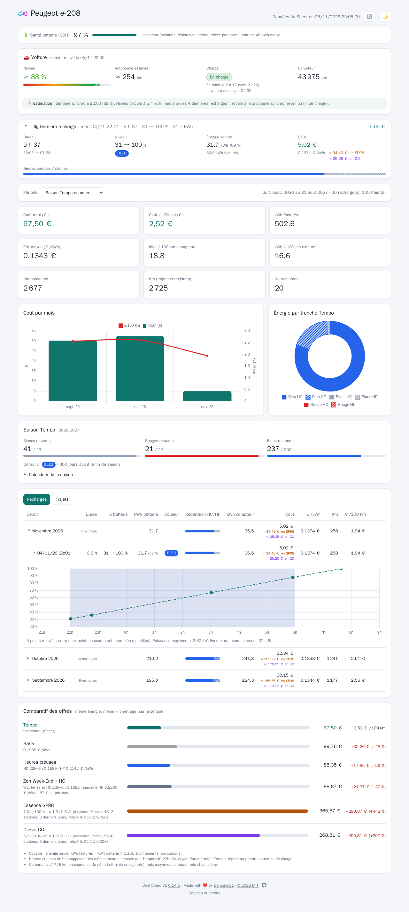
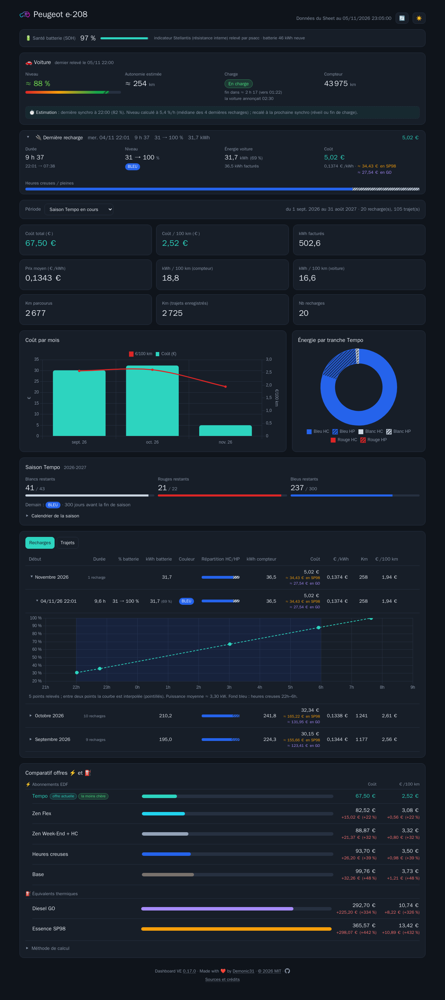
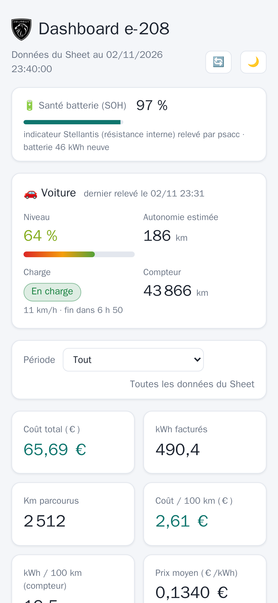
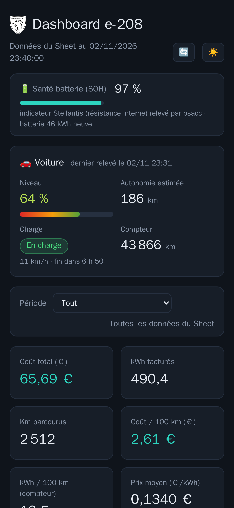

# ev-dashboard-cost-tracker : suivi des recharges d'une e-208 et coût EDF Tempo

Enregistre automatiquement chaque recharge et chaque trajet d'une **Peugeot e-208** avec [psa_car_controller](https://github.com/flobz/psa_car_controller) (psacc), puis les pousse toutes les heures dans un **Google Sheet** qui calcule le coût réel en **EDF Tempo** et le coût aux 100 km.

| Service | Rôle |
| :--- | :--- |
| `psacc` | Image officielle `flobz/psa_car_controller` : connexion au compte MyPeugeot, enregistrement des positions, charges et courbes de charge dans `psacc/config/info.db` (option `-r`), tableau de bord web sur le port 5000 (réseau local uniquement). |
| `psacc-sheets-sync` | Petit service Python ([`sync/psacc_sheets_sync.py`](sync/psacc_sheets_sync.py)) qui lit une copie de la base psacc, récupère les couleurs Tempo et met à jour le Sheet toutes les heures. |
| `e208-dashboard` | Front web en lecture seule ([`web/`](web/)) sur le port 8080 (réseau local uniquement) : copie fidèle des valeurs du Sheet, filtres par période, saison Tempo, comparatif des offres. |

## 📸 Aperçu

Captures du front web avec des **données fictives**.

| | Clair | Sombre |
| :--- | :---: | :---: |
| **PC** |  |  |
| **Mobile** |  |  |

---

## 📋 Prérequis

* Docker et le plugin `docker compose` ; l'utilisateur dans le groupe `docker` (`sudo usermod -aG docker $USER`, puis se reconnecter).
* Un compte **MyPeugeot** sur lequel l'e-208 est rattachée (le code PIN de l'application et un téléphone pour l'OTP par SMS).
* Un **Google Sheet** au format attendu (onglets `Recharges`, `Trajets`, `Couleurs Tempo`, `Paramètres`) et un **compte de service Google Cloud** (gratuit, sans facturation).

## 🔑 Compte de service Google

Dans **Cloud Shell** (icône `>_` de https://console.cloud.google.com) :

```bash
export PROJECT=e208-cost-tracker-$(date +%s | tail -c 6) SA=psacc-sheets-sync
gcloud projects create $PROJECT --name="e208 cost tracker" && gcloud config set project $PROJECT
gcloud services enable sheets.googleapis.com iam.googleapis.com
gcloud iam service-accounts create $SA --display-name="psacc sheets sync"
gcloud iam service-accounts keys create ~/google-sa.json --iam-account=$SA@$PROJECT.iam.gserviceaccount.com
cloudshell download ~/google-sa.json && rm ~/google-sa.json
```

> ℹ️ Si `keys create` répond `Unknown service account`, l'API IAM n'était pas encore active : relancer `service-accounts create` puis `keys create`.

Copier ensuite la clé sur le serveur (Windows : `"$env:USERPROFILE\Downloads\google-sa.json"`) :

```bash
scp google-sa.json <user>@<serveur>:<chemin>/secrets/google-sa.json
chmod 600 secrets/google-sa.json
```

Puis **partager le Sheet** avec l'adresse `client_email` du JSON (`psacc-sheets-sync@<projet>.iam.gserviceaccount.com`) en **Éditeur**, sans notification.

## 🚀 Installation

```bash
git clone git@github.com:Demonic31/ev-dashboard-cost-tracker.git && cd ev-dashboard-cost-tracker
cp .env.example .env          # LAN_IP, SPREADSHEET_ID, prix du comparatif…
mkdir -p psacc/config secrets && chmod 700 secrets
docker compose up -d psacc
```

1. **Connexion MyPeugeot** : ouvrir `http://<LAN_IP>:5000/config`, choisir **Peugeot** et le pays, saisir e-mail et mot de passe MyPeugeot, puis sur la page OTP demander le **SMS** et saisir le code avec le **PIN** de l'application.
2. **Réglages** (`psacc/config/config.ini`, conteneur arrêté car il appartient à root et psacc le réécrit) : section `[Electricity config]`, `day price`, `night price`, `night hour start = 22h00`, `night hour end = 6h00`. Ces prix ne servent qu'au tableau de bord psacc ; le vrai calcul Tempo est fait dans le Sheet.
3. **Batterie** : psacc la déduit du modèle (`battery_power` dans `cars.json`, 46 kWh pour une e-208 d'avant 2023, 51 kWh après). Si d'autres véhicules sont rattachés au compte, mettre l'e-208 **en premier** dans `cars.json` (le tableau de bord affiche le premier véhicule).
4. **Synchro** : un essai à blanc, un passage réel, puis le service en continu :

```bash
docker compose run --rm psacc-sheets-sync --once --dry-run
docker compose run --rm psacc-sheets-sync --once
docker compose up -d psacc-sheets-sync
docker compose logs -f psacc-sheets-sync
```

## 🔍 Fonctionnement de la synchro

* **Lecture** : copie de `info.db` (+ WAL) dans un dossier temporaire à chaque passage ; la base psacc, montée en lecture seule, n'est jamais verrouillée. Les dates psacc sont en **UTC** et sont converties en heure de Paris (`YYYY-MM-DD HH:MM:SS`, écrites en `USER_ENTERED` : le Sheet en `fr_FR` les reconnaît comme dates).
* **Couleurs Tempo** (`A:B`) : [api-couleur-tempo.fr](https://www.api-couleur-tempo.fr) (`/api/joursTempo?periode[]=2025-2026` pour l'historique, `/api/jourTempo/today|tomorrow`), de la première charge (à défaut la première position) jusqu'à demain si publié.
* **Recharges** (`A:N` uniquement) : une ligne par charge **terminée** (`battery.stop_at` renseigné), identifiant `C-<début UTC>`. Les kWh (`battery.kw` = capacité × % gagné) sont répartis en Bleu/Blanc/Rouge × HC/HP : jour Tempo = `date(t − 6h)`, HC de 22h à 6h, au prorata du % gagné entre deux points de la **courbe de charge** (`battery_curve`), à défaut au prorata du temps. Une charge dont une couleur n'est pas encore connue est reprise au passage suivant. Compteur km : celui du début de charge, sinon la dernière position connue avant la charge.
* **Trajets** (`A:G` uniquement) : psacc ne stocke pas les trajets ; ils sont recalculés depuis la table `position` avec **les mêmes règles que psacc** (arrêt si vitesse moyenne quasi nulle, recharge détectée ou trou de plus de 2 h ; trajets aberrants écartés). Le dernier trajet n'est écrit que lorsqu'il est clos.
* **Réveil pendant la charge** : à chaque heure de `WAKEUP_AT` (par défaut 3h et 5h55), la synchro lit le dernier état connu dans le cache de psacc (`/get_vehicleinfo/<VIN>?from_cache=1`, sans réveil). Si la voiture est « en charge », elle demande un réveil à psacc (`/wakeup/<VIN>`) : la voiture renvoie son état et psacc ajoute un point à la courbe de charge (milieu de nuit, et niveau juste avant la fin des heures creuses). Aucun réveil sinon, ni en `DRY_RUN`. Test manuel : `docker compose run --rm psacc-sheets-sync --check-wakeup --dry-run`.
* **Trajets saisis à la main** (p. ex. import d'un export CSV MyPeugeot) : identifiant `M-<début UTC>` (tout ID ne commençant pas par `T-`). La synchro ne les modifie jamais et n'écrit pas un trajet psacc qui chevauche leur plage horaire. Sans conso connue, laisser `E:F` vides : le kWh/100 km (voiture) du `Dashboard` ne compte que les km des trajets dont les kWh sont renseignés.
* **Km de la première charge** (`Recharges!U2`) : faute de charge précédente, la référence est le dernier compteur des `Trajets` terminés avant le jour de la charge (compteur de fin de journée), à défaut le compteur au départ du premier trajet du jour de la charge.
* **Charges saisies à la main** (`Recharges`, ID ne commençant pas par `C-`, source p. ex. `manuel (estimation)`) : gardées telles quelles par la synchro, triées par date avec les autres.
* **Écriture** : jamais la ligne 1 ni les colonnes de formules (`O:W` des recharges, `H` des trajets), aucune insertion de ligne (la formule `U2` utilise des plages fixes). Upsert par identifiant, lignes gardées triées par date de début ; si une charge doit s'intercaler, les lignes suivantes sont décalées dans `A:N` et un avertissement invite à vérifier les notes de la colonne `O`. Une lecture et au plus deux écritures groupées par passage (quotas Sheets), avec reprise automatique sur erreur 429/5xx. Relancer ne crée aucun doublon.

| Variable (`.env`) | Défaut | Rôle |
| :--- | :--- | :--- |
| `LAN_IP` | — | IP locale sur laquelle psacc écoute (jamais `0.0.0.0`) |
| `PSACC_VERSION` | `v3.7.10` | Tag de l'image psacc |
| `SPREADSHEET_ID` | — | ID du Google Sheet |
| `VIN` | vide | VIN de l'e-208 ; vide = premier véhicule électrique de `cars.json` |
| `SYNC_INTERVAL` | `3600` | Secondes entre deux passages |
| `DRY_RUN` | `false` | `true` : calcule et journalise sans écrire (et n'envoie aucun réveil) |
| `WAKEUP_AT` | `03:00,05:55` | Heures (Paris) de réveil de la voiture, seulement si une charge est en cours ; vide = jamais |
| `DASHBOARD_PORT` | `8080` | Port du front web (publié sur `LAN_IP` uniquement) |
| `DASHBOARD_CACHE_SECONDS` | `300` | Durée du cache des données du Sheet côté front |
| `BASE_PRICE_KWH` | vide | Prix TTC du kWh en option Base |
| `HCHP_HC_PRICE_KWH` / `HCHP_HP_PRICE_KWH` | vide | Prix HC / HP de l'option Heures creuses |
| `ZEN_LOW_PRICE_KWH` / `ZEN_HIGH_PRICE_KWH` | vide | Prix bas (week-end, fériés, HC semaine) / haut (HP semaine) de Zen Week-End + HC |
| `PETROL_L_100KM` | vide | Consommation de la voiture thermique de référence (L/100 km) |
| `PSACC_URL` | `http://psacc:5000` | API web de psacc pour le SOH et l'état de la voiture (fixée dans `docker-compose.yml`) |
| `BATTERY_KWH` | vide | Capacité de la batterie (kWh) : affiche dans le tableau des recharges les kWh batterie en % de la capacité (vide = pas de %) |
| `PETROL_FUEL` | `sp98` | Carburant (`sp98`, `sp95`, `e10`, `e85`, `gazole`, `gplc`) |
| `PETROL_DEPARTEMENT` | vide | Code département pour le prix moyen ; vide = France entière |

## 🖥️ Front web

```bash
docker compose up -d --build e208-dashboard
```

Puis ouvrir `http://<LAN_IP>:8080`. La page affiche ce que le Sheet a calculé, sans rien recalculer de son côté :

* **Indicateurs, coût par mois, énergie par tranche** : en période « Tout », ce sont les valeurs du `Dashboard` ; pour une autre période (saison Tempo, 12 derniers mois, mois, dates libres), les mêmes formules sont appliquées aux lignes de `Recharges` et `Trajets` de la période. Par défaut, la page s'ouvre sur le **mois en cours** ; la période choisie ensuite est mémorisée dans le navigateur.
* **Santé batterie (SOH)**, en haut de page : dernier SOH relevé par psacc (champ « resistance » de l'API Stellantis, qui ne mesure pas forcément la capacité restante), lu sur l'API web de psacc par le réseau Docker interne (`/get_vehicles` et `/battery/soh/<VIN>`, lecture seule, sans appel à Stellantis), relu toutes les heures.
* **Voiture**, sous le SOH : niveau de batterie (couleur du rouge au vert selon la charge), autonomie estimée, état de charge (en charge, terminée, arrêtée, échec, débranchée) et compteur. Valeurs du dernier envoi de la voiture, lues dans le cache de psacc (`/get_vehicleinfo/<VIN>?from_cache=1` : la voiture n'est jamais réveillée), relues toutes les 5 min.
  * **Charge en cours estimée** : la voiture n'envoie son état qu'au début de la charge, environ 45 min après, à la fin et aux réveils de `WAKEUP_AT`. Entre deux, le niveau, l'autonomie (au prorata du niveau) et l'heure de fin sont **extrapolés** depuis le dernier relevé et recalculés chaque minute dans la page, avec un encart « Estimation » qui rappelle l'heure de la dernière synchro ; la part estimée de la jauge est hachurée. Vitesse de charge (% par heure, sa source est indiquée dans l'encart) : mesurée dans la charge en cours dès que deux relevés sont espacés d'au moins 1 h, sinon médiane des 10 dernières recharges, sinon déduite du temps restant annoncé par la voiture (souvent optimiste ; son heure de fin reste affichée pour comparer). Chaque nouveau relevé sert de nouveau point de départ. Une fois l'heure de fin estimée passée, la charge est affichée « probablement terminée » ; au-delà de 14 h sans relevé, plus d'estimation (une charge interrompue ne se voit qu'à la synchro suivante).
* **Trajets par mois**, dans le tableau des trajets : une ligne par mois (du plus récent au plus ancien) avec le nombre de trajets, les km, les kWh, le kWh/100 km et le dernier compteur ; un clic déplie les trajets du mois (replié par défaut).
* **Recharges par mois**, dans le tableau des recharges : une ligne par mois avec le nombre de recharges, les kWh batterie et compteur, la répartition HC/HP, le coût, le €/kWh, les km et le €/100 km ; un clic déplie les recharges du mois (replié par défaut).
* **Équivalent essence de chaque recharge**, sous son coût (et en total sur la ligne du mois) : ce qu'aurait coûté le même trajet en voiture thermique. Km de la ligne (colonne « Km », compteur) quand ils sont connus, sinon km permis par la recharge = kWh batterie ÷ consommation moyenne des `Trajets` (kWh/100 km) ; × `PETROL_L_100KM` × prix moyen du carburant **le jour de la recharge** (même moyenne que ci-dessous, appliquée aux [archives journalières officielles](https://www.prix-carburants.gouv.fr/rubrique/opendata/)). Ces prix passés sont téléchargés en tâche de fond (un fichier d'environ 1 Mo par jour de recharge, une seule fois) et gardés dans le volume Docker `dashboard-data` ; en attendant, et pour les recharges du jour, c'est le prix actuel qui sert. Le détail du calcul s'affiche au survol.
* **Courbe de charge**, dans le tableau des recharges : un clic sur une recharge déplie le graphique du niveau de batterie selon l'heure, heures creuses en fond (replié par défaut). Les points viennent de la table `battery_curve` de psacc, lue sur une copie de `info.db` (`psacc/config` monté en lecture seule, relu toutes les 5 min). La voiture n'envoie que 2 ou 3 points par charge lente (début, ~45 min, fin), donc la courbe est interpolée entre eux. Une recharge saisie à la main est tracée en droite du début à la fin. Le survol donne la puissance moyenne entre deux points (si `BATTERY_KWH` est renseigné).
* **Saison Tempo** (1er septembre → 31 août) : jours blancs, rouges et bleus restants, couleur du lendemain et calendrier de la saison (replié par défaut, un clic le déplie), depuis [api-couleur-tempo.fr](https://www.api-couleur-tempo.fr) (cache d'une heure).
* **Comparatif des offres**, pour la même énergie (kWh facturés de la période) et hors abonnements. Une offre dont le prix n'est pas renseigné est signalée « à renseigner » :
  * **Tempo** : ton coût réel, calculé par le Sheet ;
  * **Base** : kWh × `BASE_PRICE_KWH` ;
  * **Heures creuses** : la part HC/HP de chaque charge, tirée des colonnes `H:M`, avec les mêmes heures creuses que Tempo (onglet `Paramètres`) ;
  * **Zen Week-End + HC** : prix bas le week-end, les jours fériés et en heures creuses en semaine, au prorata du temps de charge ;
  * **Essence** : km parcourus (le plus grand entre les trajets enregistrés et le compteur entre recharges) × `PETROL_L_100KM` × prix moyen du carburant. Ce prix est la moyenne des stations mises à jour ces 3 derniers jours, en France ou dans un département, d'après les [données officielles prix-carburants](https://data.economie.gouv.fr/explore/dataset/prix-des-carburants-en-france-flux-instantane-v2/), relues une fois par jour (et au redémarrage du conteneur ; le bouton 🔄 « Actualiser » ne les relit pas).

Le serveur relit le Sheet au plus toutes les `DASHBOARD_CACHE_SECONDS`. Le bouton 🔄 (Actualiser) force la relecture. Le compte de service n'y a qu'un accès en lecture.

Tout est servi par le conteneur (Chart.js et logo compris, dans `web/static/vendor/`), avec une politique de sécurité stricte (`Content-Security-Policy` sans script externe ni inline, `X-Frame-Options: DENY`, `nosniff`).

### 🔐 Mire de connexion et accès distant

Le dashboard peut demander un **mot de passe unique**, défini au niveau du conteneur, pour être publié sur Internet derrière un reverse proxy qui gère le 443 et le certificat HTTPS : le **proxy intégré** (Caddy, voir plus bas), un Synology, ou tout autre.

| Variable | Défaut | Rôle |
| :--- | :--- | :--- |
| `DASHBOARD_PASSWORD_HASH` | vide | Empreinte **scrypt** du mot de passe (le mot de passe en clair n'est stocké nulle part). Vide = pas de mire. La changer déconnecte toutes les sessions. |
| `DASHBOARD_TOTP_SECRET` | vide | Clé TOTP : un code à 6 chiffres d'application d'authentification (Aegis, 2FAS, Google Authenticator…) est demandé après le mot de passe. Vide = mot de passe seul. La changer déconnecte toutes les sessions. |
| `SESSION_SECRET` | vide | Clé de signature des sessions (`openssl rand -hex 32`) ; vide = clé aléatoire, sessions perdues à chaque redémarrage |
| `TRUSTED_PROXY` | vide | Reverse proxy : son IP LAN (Synology…), ou `caddy` avec le proxy intégré (nom résolu par Docker). Seul son en-tête `X-Real-IP` (IP réelle du visiteur) est cru. |
| `LOGIN_SCOPE` | `proxy` | `proxy` : mot de passe pour les accès via le proxy, accès LAN direct libre ; `all` : partout. Tant que `TRUSTED_PROXY` est vide, le mot de passe est demandé partout. |

Garde-fous : une requête qui porte des en-têtes de reverse proxy (`X-Forwarded-For`, `X-Real-IP`…) sans venir de `TRUSTED_PROXY` est traitée comme venant d'Internet (mot de passe exigé, en-têtes ignorés) ; et **sans mot de passe configuré, toute requête venant d'Internet est refusée** (403) : un proxy mal réglé n'ouvre jamais le dashboard.

Générer l'empreinte (le mot de passe est demandé sans être affiché, 12 caractères minimum) :

```bash
docker compose run --rm e208-dashboard --hash-password
```

Enrôler l'application d'authentification : la commande affiche un QR code (et la clé à saisir à la main), demande un code pour vérifier, puis met la clé dans `.env` :

```bash
L=$(docker compose run --rm -T e208-dashboard --setup-totp | grep '^DASHBOARD_TOTP_SECRET=') && sed -i "s|^DASHBOARD_TOTP_SECRET=.*|$L|" .env && docker compose up -d e208-dashboard
```

* **Code TOTP** (RFC 6238, 30 s) : accepté pour la tranche en cours, la précédente ou la suivante (décalage d'horloge) ; un code déjà utilisé est refusé ; il n'est vérifié qu'avec le bon mot de passe. La clé ne peut pas être hachée (le serveur en a besoin pour calculer les codes) : elle reste dans `.env`, jamais dans git. Téléphone perdu : relancer `--setup-totp` depuis le serveur.
* **Page de connexion** : logo « voiture électrique » (aussi favicon et icône d'application), titre « Dashboard VE · Login », champs mot de passe et code, case « Se souvenir de moi » et, sous le formulaire, un bouton de thème clair / sombre (choix partagé avec le dashboard).
* **Session** : cookie signé (HMAC), `HttpOnly`, `SameSite=Lax`, `Secure` derrière le Synology ; 12 h, ou 30 jours avec « Se souvenir de moi », prolongés de 30 jours à chaque utilisation après un jour (on ne se reconnecte que si le dashboard reste plus d'un mois sans être ouvert). Lien « Déconnexion » dans l'en-tête.
* **Application Android (PWA)** : depuis Chrome sur l'adresse HTTPS publique, menu ⋮ → « Installer l'application » (l'adresse locale en HTTP ne peut pas être installée). En mode application, « Se souvenir de moi » est coché d'office. Le service worker ne garde en cache qu'une page « Hors connexion », jamais les données. Installer avec Chrome (Brave ne pose qu'un raccourci) ; si Chrome demande un nom ou si l'app garde une barre de titre, un VPN / bloqueur de pubs qui filtre le HTTPS a retiré le lien du manifeste : l'installer en le coupant, puis exclure l'adresse du filtrage.
* **Anti-brute-force** (mot de passe ou code) : après 5 échecs en 15 min, l'IP du visiteur est bloquée 15 min ; comparaison en temps constant et 1 s d'attente par échec. Les tentatives sont journalisées (`docker logs`).
* **Synology**, si tu préfères son reverse proxy au proxy intégré (DSM → Portail de connexion → Avancé → Proxy inversé → Créer) : source HTTPS `<nom>` port 443 avec HSTS, destination HTTP `<LAN_IP>` port du dashboard ; onglet En-tête personnalisé : `X-Real-IP` = `$remote_addr` et `X-Forwarded-Proto` = `$scheme`. Certificat Let's Encrypt pour `<nom>` dans Sécurité → Certificat → Ajouter, puis **Paramètres** pour l'associer à la règle (sinon le Synology présente son certificat auto-signé). Facultatif : pour qu'une adresse tapée sans `https://` aboutisse, une seconde règle avec la source **HTTP** port 80 et la même destination ; le dashboard renvoie alors vers HTTPS (redirection 301), sans jamais servir la page en clair. À n'ajouter qu'après l'obtention du certificat, et à vérifier au premier renouvellement Let's Encrypt (qui passe aussi par le port 80). Sans elle, HSTS fait passer le navigateur en HTTPS dès la première visite.

### 🌐 Accès depuis Internet avec le proxy intégré (Caddy)

Solution clé en main, sans Synology : un conteneur [Caddy](https://caddyserver.com/) (profil compose `proxy`, facultatif) reçoit les connexions sur les ports 80 et 443, obtient et renouvelle seul le certificat **Let's Encrypt**, redirige HTTP vers HTTPS (avec HSTS) et transmet au dashboard l'IP réelle du visiteur. Seul le dashboard est publié : psacc (port 5000) reste sur le LAN.

1. **Nom de domaine** : un enregistrement DNS `A` (et `AAAA` en IPv6) de ton domaine, p. ex. `ve.example.fr`, vers l'IP publique de ta box. IP publique qui change : un DNS dynamique (DynDNS, DuckDNS, celui de ta box…).
2. **Box** : rediriger les ports **TCP 80 et 443** (et UDP 443, facultatif, pour HTTP/3) vers l'IP LAN du serveur. Jamais 5000 ni 8080. Le port 80 sert à Let's Encrypt (validation et renouvellement) et à la redirection vers HTTPS.
3. **`.env`** : la mire (mot de passe, de préférence code TOTP, `SESSION_SECRET` : voir ci-dessus), puis :
   ```bash
   DASHBOARD_DOMAIN=ve.example.fr
   TRUSTED_PROXY=caddy
   ```
4. **Démarrer** :
   ```bash
   docker compose --profile proxy up -d
   docker logs -f e208-caddy   # attendre « certificate obtained successfully »
   ```
5. Ouvrir `https://ve.example.fr` : la mire de connexion s'affiche.

* Certificats et clés dans les volumes `caddy-data` / `caddy-config` (à ne pas supprimer : Let's Encrypt limite le nombre de demandes).
* Configuration dans [`proxy/Caddyfile`](proxy/Caddyfile) ; version de Caddy figée par `CADDY_VERSION` (défaut `2.8.4-alpine`).
* Échec du certificat : vérifier le DNS (`nslookup ve.example.fr`), la redirection du port 80 depuis l'extérieur (pas depuis le LAN : beaucoup de box ne gèrent pas le « hairpin ») et les journaux de Caddy.
* Couper l'accès depuis Internet : `docker compose stop caddy` (le dashboard reste accessible sur le LAN).
* Sans mot de passe configuré, Caddy obtient le certificat mais le dashboard répond 403 aux requêtes venant d'Internet.

### 🧪 PREPROD

[`preprod/docker-compose.yml`](preprod/docker-compose.yml) lance un second dashboard (projet `e208-preprod`, port `8081` sur l'IP LAN) avec le code de la branche en cours, pour tester sans toucher à la PROD. Il lit le même Sheet et la base et l'API psacc de la pile principale, en lecture seule, sans synchro ni réveil. Son app installable s'appelle « VE PREPROD », avec une icône et un logo de mire marqués « TEST » (`APP_LABEL`), pour la distinguer de celle de la PROD.

```bash
cp preprod/.env.example preprod/.env && chmod 600 preprod/.env   # chemins de la pile principale, mot de passe, Synology
preprod/preprod.sh on    # (re)lance le dashboard avec le code du worktree
preprod/preprod.sh off   # l'arrête et affiche à sa place la page « PREPROD en pause »
```

Arrêtée, la PREPROD n'est pas coupée du Synology : un petit serveur (`web/pause_server.py`, même image, profil `pause`) répond sur le même port avec une page « PREPROD en pause » aux couleurs du dashboard (code 503), au lieu de la page d'erreur du Synology. `PAUSE_LINK` (dans `preprod/.env`) y ajoute un bouton vers la PROD.

## 🔄 Mise à jour

```bash
# psacc : changer PSACC_VERSION dans .env (voir https://github.com/flobz/psa_car_controller/releases)
docker compose pull psacc && docker compose up -d psacc
# synchro et front : après git pull ou modification du code
git pull
docker compose build psacc-sheets-sync && docker compose up -d psacc-sheets-sync
docker compose up -d --build e208-dashboard
# proxy intégré (si utilisé) : changer CADDY_VERSION dans .env
docker compose --profile proxy pull caddy && docker compose --profile proxy up -d caddy
```

## 💾 Sauvegarde

Tout l'état est dans `psacc/config/` (session Stellantis, `cars.json`, `config.ini`, base `info.db`) et `secrets/` : à sauvegarder **conteneur arrêté** pour une base cohérente.

```bash
docker compose stop psacc
tar czf ~/psacc-config-$(date +%F).tar.gz psacc/config --exclude='*.apk*'
docker compose start psacc
```

Les fichiers `mypeugeot.apk*` (~120 Mo) sont retéléchargés automatiquement et n'ont pas besoin d'être sauvegardés.

## 🔐 Relancer la connexion si la session expire

Symptômes : `Please reconnect by going to config web page` dans `docker compose logs psacc`, plus de nouvelles positions, la synchro ne voit plus de nouvelles charges.

1. Ouvrir `http://<LAN_IP>:5000/config` et refaire la connexion (marque, identifiants MyPeugeot, OTP par SMS + PIN).
2. `docker compose restart psacc`, puis vérifier les logs (`access token refreshed`, `new position recorded`).

Les données déjà enregistrées sont conservées ; rien à faire côté synchro.

## 🔒 Sécurité

* `.env`, `secrets/` et `psacc/config/` (jetons Stellantis, VIN, positions GPS) sont exclus de git.
* La clé Google est montée en *secret* Docker en lecture seule ; la synchro tourne en utilisateur non root et monte la config psacc en lecture seule.
* Le front (port 8080) n'est publié que sur l'IP locale, comme psacc ; pour un accès depuis Internet, il passe par un reverse proxy (Caddy intégré ou Synology) et la mire de connexion. Sans mot de passe configuré, les requêtes venant d'Internet sont refusées.
* Le port 5000 n'est publié que sur l'IP locale : ne pas l'exposer sur Internet (l'interface permet de piloter la voiture).
